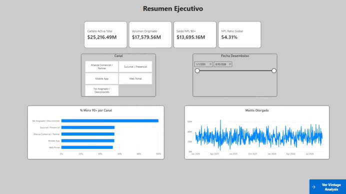

# 🚀 Fintech Credit Risk — Modern Data Stack (End-to-End Pipeline & Analytics)

> **Pipeline Analítico Integral (GCP Free Tier, $0 USD)**: Plataforma analítica y de ingeniería de datos para evaluación de riesgo crediticio, seguimiento de mora y análisis de cosechas (*Vintage Analysis*) en una entidad fintech. El pipeline procesa eventos JSON crudos, resuelve granularidades de cuotas/préstamos y estructura modelos dimensionales Kimball servidos hacia una capa semántica (`rpt_`) consumida por un dashboard ejecutivo interactivo en Power BI.



---

## ❓ 1. Preguntas Guía del Análisis (Descriptivas)

Para evaluar el desempeño del negocio crediticio y la calidad del portafolio, el análisis busca responder las siguientes preguntas fundamentales:

1. **Magnitud de Colocación y Cartera:** ¿Cuál es el volumen total originado y el tamaño de la cartera activa acumulada por la entidad?
2. **Nivel de Morosidad Global (NPL 90+):** ¿Qué proporción de la cartera se encuentra en mora pesada (más de 90 días de atraso) y a cuánto asciende el saldo en riesgo?
3. **Comportamiento por Canal de Originación:** ¿Existe diferencia en la calidad crediticia según el canal por el cual se originó el préstamo (Mobile App, Web Portal, Sucursal, Alianzas)?
4. **Deterioro de Cosechas (Vintage Analysis):** ¿Cómo evoluciona la mora acumulada a 30+ días a medida que avanzan los meses de vida del crédito (*Month on Book - MOB*) según el mes de desembolso?

---

## 🎯 2. Visión General y Arquitectura del Proyecto

El proyecto implementa un pipeline analítico de extremo a extremo bajo el paradigma moderno **ELT (Extract - Load - Transform)** en la nube, combinando la arquitectura Medallion con la metodología dimensional de Ralph Kimball y una capa semántica optimizada para BI.

* **Patrón de Arquitectura:** Medallion Architecture (Bronze $\to$ Silver $\to$ Gold) + Capa Semántica Agregada (`rpt_`).
* **Stack Tecnológico:**
  * **Motor Analítico (Cloud Data Warehouse):** Google BigQuery (`fintech-credit-analytics`).
  * **Transformación y Modelado:** dbt Core (`v1.13.0-b1`) con adaptador `dbt-bigquery` (`v1.12.1`).
  * **Auditoría e Ingesta:** Python 3.11+, BigQuery Python SDK, Pandas, Faker.
  * **Paquetes dbt Oficiales:** `dbt-labs/codegen` (`0.13.0`), `dbt-labs/dbt_utils` (`1.4.1`).
  * **Business Intelligence:** Power BI Desktop (Dashboard interactivo en 2 páginas con DAX y Navegación).

### 🧱 Flujo por Capas (Arquitectura Medallion)

* 🟤 **Bronze (Staging - `stg_`):** Ingesta de eventos JSON crudos desde `raw_vault`. Parseo, tipado estricto (`NUMERIC`, `DATE`) y desestructuración resiliente con `SAFE_CAST` manteniendo granularidad 1:1.
* ⚪ **Silver (Intermediate - `int_`):** Limpieza de reglas de negocio, resolución del *fan-out* entre préstamos y cuotas (`int_pagos_por_solicitud`), y cálculo dinámico de mora real.
* 🟡 **Gold (Marts & Semántica - `dim_`, `fct_`, `rpt_`):** Almacén dimensional Kimball (Esquema en Estrella con SCD2 y claves comodín) + capa semántica precalculada (`rpt_`) optimizada para Power BI.

---

## 🔍 3. Diagnóstico Técnico de Fuentes (Hallazgos en EDA) y Calidad de Datos

Durante la fase de análisis exploratorio en Python/Pandas sobre el dataset `raw_vault`, se auditaron las fuentes crudas y se detectaron anomalías estructurales que justificaron las reglas de limpieza y testing en dbt:

* **Anomalía de Tasas de Interés (`raw_solicitudes`):** Se identificaron **5 créditos con tasa nominal anual negativa (`-0.15`)**, violando la lógica financiera. Fueron aislados mediante un *Singular Data Test* en dbt (`assert_data_interes_positiva.sql`).
* **Acotamiento de Mora en Origen (`raw_pagos`):** Los eventos de pago recibidos en formato JSON limitaban la columna `dias_mora` a un máximo de 28 días. Se implementó un cálculo dinámico comparando `fecha_vencimiento` contra `fecha_pago_real` o `CURRENT_DATE()`.
* **Claves Huérfanas de Canales:** Se detectaron 8 operaciones asociadas a un `id_canal = 999` inexistente en el catálogo. Se resolvió creando la clave comodín `id_canal = -1` (*"No Asignado / Desconocido"*) en `dim_canales.sql`.
* **SCD Tipo 2 en Clientes:** La tabla `raw_clientes` presentaba duplicados legítimos por actualizaciones de score bancario o ingresos. Se implementó deduplicación en `dim_clientes.sql` mediante `ROW_NUMBER() OVER (PARTITION BY id_cliente ORDER BY fecha_actualizacion DESC)`.

---

## 📊 4. Hallazgos Clave de Negocio (Resultados del Análisis)

Consolidando los datos transformados a través de la capa semántica (`rpt_`) y el dashboard ejecutivo en Power BI, se obtuvieron las siguientes respuestas a las preguntas guía:

### 4.1. Magnitud de Colocación y Cartera Activa

* **Volumen Total Originado:** `$17.579,56M` en créditos colocados históricamente.
* **Cartera Activa Total:** `$25.216,49M` bajo gestión (capital pendiente + compromisos de cuotas).

### 4.2. Diagnóstico de Morosidad Global (NPL 90+)

* **Saldo en Default Técnico:** `$13.695,16M` en créditos con más de 90 días de atraso.
* **NPL Ratio Global:** **54,31%** del portafolio se encuentra en mora pesada, lo que evidencia la necesidad de ajustar las políticas de originación.

### 4.3. Comparativa por Canal de Originación

* **Mejor Desempeño:** **Web Portal** (**53,06%** NPL 90+).
* **Desempeño Intermedio:** **Mobile App** (**54,54%**), **Alianza Comercial** (**54,66%**) y **Sucursal** (**54,84%**).
* **Aislamiento de Basura Operativa:** El canal **No Asignado / Desconocido** refleja un **100,00%** de mora, confirmando que la clave comodín (`id_canal = -1`) absorbió exitosamente los datos defectuosos del backend sin contaminar los canales comerciales.

### 4.4. Dinámica de Cosechas (Vintage Analysis por MOB)

* **Curva de Deterioro:** La mora acumulada a 30+ días acelera drásticamente entre el **MOB 1 y MOB 3**.
* **Cohortes Críticas:** La matriz de cosecha destaca cohortes específicas (ej. `2025-03` y `2025-07`) con un deterioro significativamente más rápido que el promedio general, señalando períodos de relajación en los filtros de evaluación crediticia.

---

## 🛠️ 5. Estructura del Repositorio y Pipeline ELT

```text
Fintech-Credit-Risk---Modern-Data-Stack/
├── .gitattributes
├── .gitignore
├── README.md
├── requirements.txt
├── assets/
│   └── dashboard.gif                    <-- Vista previa animada del dashboard
├── dashboards/
│   └── fintech_credit_analysis.pbix      <-- Dashboard ejecutivo en Power BI
├── extractors/                           <-- Scripts de extracción e ingesta cruda
│   ├── mock_fintech_generator.py         <-- Generador sintético de eventos con Faker
│   └── load_to_bigquery.py               <-- Carga batch al dataset raw_vault
├── notebooks/                            <-- EDA inicial y diagnóstico de fuentes
│   └── 01_eda_credit_risk.ipynb          <-- Auditoría de calidad, outliers y mora
└── fintech_credit/                       <-- Proyecto dbt Core
    ├── .gitignore
    ├── README.md                         <-- README estándar de dbt
    ├── analyses/
    │   └── .gitkeep                      <-- Consultas ad-hoc (sin uso actual)
    ├── dbt_project.yml                   <-- Configuración principal de dbt
    ├── macros/
    │   └── .gitkeep                      <-- Macros propias del proyecto
    ├── models/
    │   ├── staging/                      <-- Bronze: 1:1 con raw_vault, parseo JSON
    │   │   ├── sources.yml               <-- Declaración de fuentes BigQuery
    │   │   ├── schema.yml                <-- Tests genéricos de staging
    │   │   ├── stg_solicitudes.sql
    │   │   ├── stg_clientes.sql
    │   │   └── stg_pagos.sql
    │   ├── intermediate/                 <-- Silver: fan-out fix y lógica de negocio
    │   │   ├── schema.yml
    │   │   ├── int_pagos_por_solicitud.sql
    │   │   └── int_solicitudes_enriquecidas.sql
    │   └── marts/                        <-- Gold: Kimball + capa semántica rpt_
    │       ├── schema.yml
    │       ├── dim_calendario.sql        <-- Dimensión temporal dinámica
    │       ├── dim_clientes.sql          <-- Deduplicación SCD2 (ROW_NUMBER)
    │       ├── dim_canales.sql           <-- Catálogo con fila comodín id_canal = -1
    │       ├── fct_prestamos.sql         <-- Hecho acumulativo (particionado por fecha_desembolso)
    │       ├── fct_pagos_cuotas.sql      <-- Hecho transaccional atómico (días de mora dinámicos)
    │       ├── rpt_vintage_analysis.sql  <-- Matriz cohorte × MOB (mora 30+ acumulada)
    │       └── rpt_resumen_riesgo_mora.sql <-- KPIs ejecutivos por canal (NPL 90+)
    ├── package-lock.yml
    ├── packages.yml
    ├── seeds/
    │   └── .gitkeep                      <-- Sin seeds por ahora
    ├── snapshots/
    │   └── .gitkeep                      <-- Sin snapshots; la SCD2 se resuelve en dim_clientes
    └── tests/                            <-- Singular Data Tests (reglas financieras)
        ├── .gitkeep
        ├── assert_data_interes_positiva.sql
        ├── assert_fecha_desembolso_valida.sql
        └── assert_pagos_consistentes.sql
```

### 🗂️ Guía rápida de carpetas

| Ruta | Qué contiene / para qué sirve |
| --- | --- |
| `extractors/` | Scripts de Python que generan eventos sintéticos y los cargan en `raw_vault` (Bronze). |
| `notebooks/` | EDA y diagnóstico de calidad de las fuentes antes de escribir modelos dbt. |
| `fintech_credit/models/staging/` | Modelos `stg_`: transición Bronze → Silver, 1:1 con la fuente, sin joins ni agregaciones. |
| `fintech_credit/models/intermediate/` | Modelos `int_`: lógica de negocio, cambio de granularidad y mitigación de *fan-out*. |
| `fintech_credit/models/marts/` | Capa Gold: dimensiones (`dim_`), hechos (`fct_`) y capa semántica (`rpt_`) para BI. |
| `fintech_credit/tests/` | *Singular tests* con reglas de negocio financieras. |
| `fintech_credit/analyses/`, `macros/`, `seeds/`, `snapshots/` | Espacios de soporte de dbt; actualmente solo contienen `.gitkeep`. |
| `dashboards/` | Archivo `.pbix` del dashboard ejecutivo de Power BI. |
| `assets/` | Recursos visuales del repositorio, como el GIF de vista previa. |

> **Archivos locales no versionados:** `.venv/`, `logs/`, `fintech_credit/target/`, `fintech_credit/dbt_packages/`, `gcp-credentials.json` y `.obsidian/`. No forman parte del repositorio; `gcp-credentials.json` contiene credenciales y está excluido por `.gitignore`.

---

## ⚙️ 6. Desafíos Técnicos de Ingeniería Resueltos

### 6.1. Resolución de Granularidad y Mitigación de Fan-Out

El cruce entre solicitudes (8.000 filas) y cuotas (129.834 filas) provocaba duplicación de importes. Se creó `int_pagos_por_solicitud` para pre-agregar indicadores a nivel de solicitud antes del cruce dimensional.

### 6.2. Cálculo Dinámico de Días de Mora (`fct_pagos_cuotas`)

Se reemplazó el atributo acotado del backend por una fórmula en dbt que calcula los días reales comparando `fecha_vencimiento` contra `fecha_pago_real` o `CURRENT_DATE()`.

### 6.3. Cálculo de MOB (Month on Book) en Vintage Analysis

Se implementó el cálculo preciso en meses transcurridos (`DATE_DIFF(fecha_vencimiento, fecha_desembolso, MONTH)`) para estructurar la matriz de cosechas.

### 6.4. Desacople Defensivo (`LEFT JOIN` y Clave Comodín `-1`)

Se inyectó la fila sintética `-1` en `dim_canales` para absorber solicitudes con canales anómalos (`999`), preservando el 100% de las operaciones aprobadas en `fct_prestamos`.

---

## 📊 7. Estructura del Dashboard Ejecutivo (Power BI)

### 7.1. Página 1: Resumen Ejecutivo (Executive Overview)

* Tarjetas KPI principales (`$25,2B` Cartera, `$17,5B` Volumen, `$13,6B` NPL 90+, `54,31%` NPL Global).
* Gráfico de barras de `% Mora 90+` segregado por canal.
* Gráfico de líneas con la evolución continua del monto otorgado.
* Filtros por Canal y Rango de Fechas con botón de navegación hacia el análisis de cosechas.

### 7.2. Página 2: Matriz de Cosechas (Vintage Analysis)

* Matriz interactiva de Cohorte vs. MOB mostrando la mora acumulada a 30+ días.
* Segmentadores por canal y fecha con botón de retorno al resumen.
